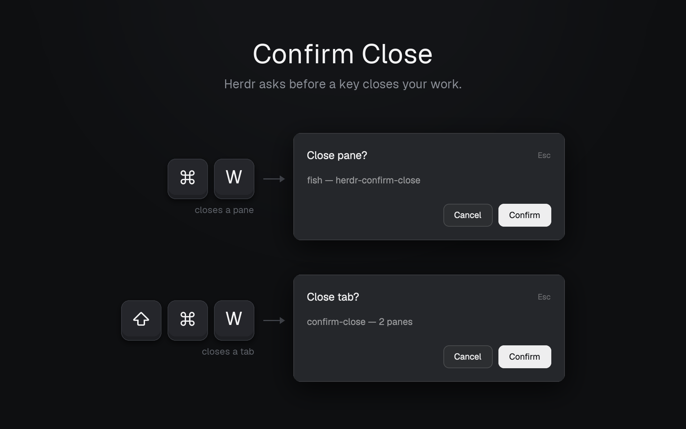

# Confirm Close for Herdr App

English · [中文](README.zh-CN.md)

Two small Herdr App mods that ask before a key closes a pane or a tab. Herdr's own `pane.close` and `tab.close` close at once; it only asks when the last tab of a space would close the space.

| Key | Asks | Then runs |
| --- | --- | --- |
| `cmd-w` | **Close pane?** `program — folder` | `pane.close` |
| `cmd-shift-w` | **Close tab?** `tab — N panes` | `tab.close` |

The dialog is Herdr's shipped `confirm` mod, at the size and in the one-line style of Herdr's own "Close space?". Enter confirms, Esc cancels. It closes the pane or tab that was focused when you pressed the key.

## Install

Ask your Herdr agent to add `herdr.dev/mods/Hariketsu/herdr-confirm-close`, or by hand:

1. Copy `mods/ask-close-pane` and `mods/ask-close-tab` into `~/.config/herdr-app/mods/`.
2. Merge `keys.json` into the `global` section of `~/.config/herdr-app/keys.json`. It replaces Herdr's default `cmd-w` (`tab.close`) and `cmd-shift-w` (`pane.close`): `cmd-w` now closes the pane, as in most terminals.
3. Run `herdr-app check` on both folders.

## Not covered

- Clicking `×` on a pane header or a tab, and running `pane.close` / `tab.close` from the command palette, still close without asking.
- Herdr won't close the last pane of a space, so confirming there does nothing. Close the space with `cmd-shift-w`; Herdr then asks "Close space?" itself.

## What it runs

Nothing outside Herdr: it reads `focused()`, `panes()` and `spaces()`, and runs `pane.close` or `tab.close` after you confirm. No network, no files, no programs.

## Uninstall

Delete the two folders and set the keys back to Herdr's defaults: `"cmd-w": "tab.close"`, `"cmd-shift-w": "pane.close"`.
