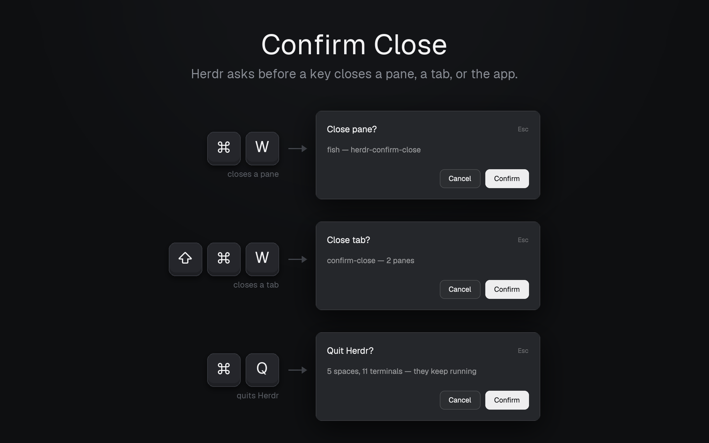

# Confirm Close

[English](README.md) · 中文

这个 mod 让 Herdr 先问一句：用快捷键关 pane、关 tab 或退出 Herdr 之前，先弹一个确认框。Enter 继续，Esc 取消。



Herdr 按下快捷键会直接关 pane 和 tab，只有在关 space 的最后一个 tab 时才会问。要是手滑按一下 cmd-w，正在跑的 agent 就没了。

cmd-q 就在 cmd-w 旁边，Herdr 退出时也不问。退出后终端还在跑，但窗口没了，手上的事被打断。确认框会把这点写明：`5 spaces, 9 terminals — they keep running`。

## 快捷键是对调的

| 快捷键 | Herdr 默认 | 装了这个 mod |
| --- | --- | --- |
| `cmd-w` | 关 tab | 确认后关 pane |
| `cmd-shift-w` | 关 pane | 确认后关 tab |
| `cmd-q` | 退出 | 确认后退出 |

`cmd-w` 关 pane 是多数终端的习惯。想保留 Herdr 原来的键位，就只装确认框（见下）。`cmd-q` 两种装法都一样。

## 安装

跟你的 Herdr agent 说：

```
Read ~/.config/herdr-app/AGENTS.md, then add this mod: https://github.com/Hariketsu/herdr-confirm-close/tree/main
```

它会问你要对调键位，还是只要确认框。

手动安装：

1. 把 `mods/ask-close-pane`、`mods/ask-close-tab` 和 `mods/ask-quit` 复制到 `~/.config/herdr-app/mods/`。
2. 在 `~/.config/herdr-app/keys.json` 的 `global` 里设 `"cmd-q": "mod.open:ask-quit"`，再加上其中一组：
   - 对调键位（跟本仓库的 `keys.json` 一样）：`"cmd-w": "mod.open:ask-close-pane"`、`"cmd-shift-w": "mod.open:ask-close-tab"`
   - 只要确认框：`"cmd-w": "mod.open:ask-close-tab"`、`"cmd-shift-w": "mod.open:ask-close-pane"`
3. 对三个文件夹分别跑一次 `herdr-app check`。

改过 `keys.json` 之后，Herdr 升级时不会再往里加新的默认快捷键。

## 已知限制

- 点 tab 或 pane 标题栏上的 `×`、在命令面板里执行关闭，不会弹确认框。
- 从菜单栏或 Dock 退出不会弹确认框，只有快捷键会问。
- 关 space 里最后一个 pane 或 tab 时，问的是 "Close space?"，因为关掉它就是关掉整个 space。

## 它会做什么

只读取当前聚焦的 pane 或 tab，数一下 space 和终端的个数，你确认后执行 `pane.close`、`tab.close` 或 `app.quit`。

## 卸载

删掉三个文件夹，把快捷键改回去：`"cmd-w": "tab.close"`、`"cmd-shift-w": "pane.close"`、`"cmd-q": "app.quit"`。
