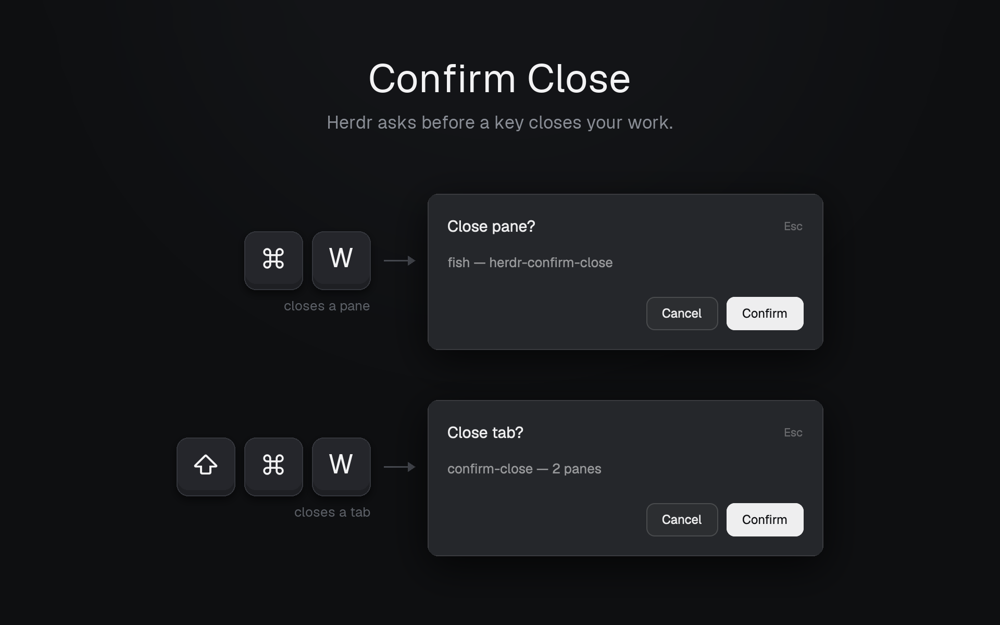

# Confirm Close

Two key-driven dialogs for Herdr App: `cmd-w` asks "Close pane?" and `cmd-shift-w` asks "Close tab?" before anything closes. They look exactly like Herdr's own "Close space?" dialog.

## What you see

- A centered dialog over the dimmed window, 380×150px: Herdr's shipped `confirm` mod (popover background, 18px padding, 15px semibold title with a dim `Esc` hint at the right, 13px `muted` detail, `Cancel` and `Confirm` buttons at the bottom right).
- **Close pane?** Detail on one line: `<name> — <folder>`.
  - Name, the rule of the shipped pane header: the program's name for a shell or an agent (`fish`, `Claude Code`), else the terminal's title, else the program's name, else `pane`.
  - Folder: only the last part of the pane's `cwd` (`modern-terminal-keybindings`), so a long path doesn't wrap and scroll. Omitted with its ` — ` when there is no `cwd` (a mod pane).
- **Close tab?** Detail: `<tab name> — <N> panes` (the tab's name, or its number when unnamed). Plural is not adjusted, as Herdr's own `1 tabs, 1 terminals`.

## How it behaves

- `cmd-w` / `cmd-shift-w` run `mod.open:ask-close-pane` / `mod.open:ask-close-tab`.
- On open, the mod closes its own overlay at once, reads the focused pane (or tab) right then, and opens the `confirm` dialog with that id. Confirm acts on that pane or tab even if focus moves while the dialog is up.
- Enter or Confirm runs `pane.close {pane}` / `tab.close {id}`. Esc, Cancel or a click beside it closes the dialog and nothing else.
- Nothing focused (no pane or no tab): no dialog.
- Agent status doesn't matter: it always asks.

## Built from

- `mods/ask-close-pane/` and `mods/ask-close-tab/`, each `main.js` + `mod.json` = `{ "place": "none", "overlay": { "kind": "dialog", "width": 1, "height": 1 } }`. The mod is only a launcher: it renders an empty `div()`.
- `herdr`: `focused()`, `panes()` (`title`, `cwd`, `program.{agent, shell, name}`), `spaces()[].tabs` (`id`, `name`, `panes`), `props().overlay`, `closeOverlay`, `openOverlay({ mod: "confirm", kind: "dialog", width: 380, height: 150, props: { title, detail, command: { name, args } } })`.
- Shipped mod: `confirm` (props `title`, `detail`, `command`; Enter runs `command`).
- `keys.json`: `global` → `"cmd-w": "mod.open:ask-close-pane"`, `"cmd-shift-w": "mod.open:ask-close-tab"`.

## Watch out

- `herdr-app check` runs `init` with `props()` null: guard `props()?.overlay`.
- `mod.open` passes no arguments, hence one mod per command.
- Fish and other shells set the terminal title to the folder: using `title` for a shell repeats the path.
- At 150px a second line of detail scrolls: keep it to one line.
- `pane.close` refuses the last pane of a space; the dialog still shows, and Confirm does nothing.
- Pane header and tab `×` buttons, and the palette, call the commands directly and don't ask.
- Changing `keys.json` makes it yours: Herdr stops adding new default keys to it on upgrade.

## Done when

- `herdr-app check` passes for both folders.
- `cmd-w` on a fish pane shows "Close pane?" with `fish — <folder>` on one line; Esc leaves the pane; Enter closes it.
- `cmd-shift-w` shows "Close tab?" with `<tab> — <N> panes`; Confirm closes the tab, and on a space's last tab Herdr then asks "Close space?".
- The dialog matches Herdr's "Close space?" in size and style.
